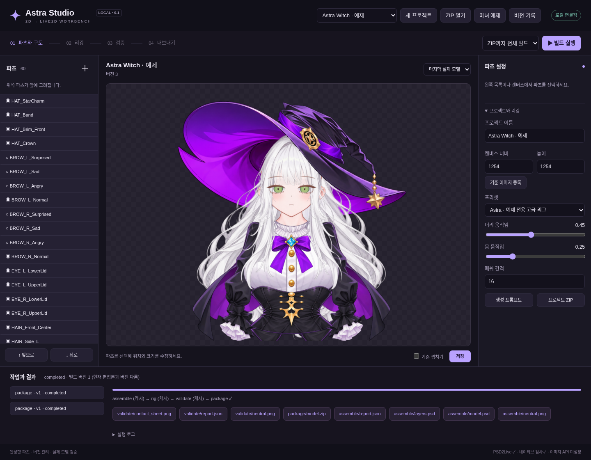

# AutomaticallyMakingVtubeModel — Astra Studio

2D 캐릭터 이미지를 바탕으로 독립 파츠를 준비하고 Live2D 모델을 제작하는 로컬 웹 프로그램입니다. 파츠 편집, PSD 생성, 실제 MOC3 빌드, 검증과 ZIP 내보내기를 하나의 프로젝트로 관리합니다.



## 실행

Linux / Python 3.11 이상:

```bash
git clone https://github.com/parkyongho0n/AutomaticallyMakingVtubeModel.git
cd AutomaticallyMakingVtubeModel
python -m venv .venv
source .venv/bin/activate
pip install -e .
python -m astra_studio serve --port 7860
```

브라우저에서 **http://127.0.0.1:7860** 을 엽니다. 새 프로젝트를 만든 뒤 기준 이미지와 완성형 파츠를 등록하세요.

## 기능

- 독립 파츠 업로드·생성 API 연동, 위치·크기·앞뒤 순서·클리핑 편집
- 저장 이력, 버전 복원, 프로젝트 ZIP 내보내기·가져오기
- 편집용 PSD와 리깅용 PSD 생성
- PSD2Live를 통한 실제 MOC3 생성, 표정 및 물리 파일 패키징
- Cubism 네이티브 검사·포즈 렌더와 품질 경고
- 독립 빌드 스냅샷, 단계별 캐시, 작업 로그·취소

PSD 조립은 기본 설치로 사용할 수 있습니다. **MOC3 생성에는 별도 PSD2Live 설치**, **이미지 생성에는 API 키**가 필요합니다. 네이티브 렌더에는 호환 브리지와 X11/OpenGL 환경이 필요합니다. SDK나 외부 실행 파일, API 키는 동봉하지 않습니다.

범용 리깅 결과는 수정 가능한 자동 초안입니다. 임의 원화 한 장만으로 방송 품질 모델을 완전 자동 완성한다고 보장하지 않습니다. 실제 웹캠·VTube Studio 검증은 별도입니다.

## 마녀 예제 사용

프로그램과 캐릭터 자산을 별도 저장소로 관리합니다. 예제 자산·전용 고급 리그가 필요할 때만 다음을 실행하세요.

```bash
git clone --branch build/astra-facial-tracking --single-branch \
  https://github.com/parkyongho0n/astra-witch-vtuber.git ../astra-witch-vtuber
python -m astra_studio --repo ../astra-witch-vtuber serve
```

그다음 화면의 **마녀 예제**를 누릅니다. 원본 모델은 변경하지 않고 프로젝트 폴더에 파츠를 복사합니다. 새 캐릭터의 범용 작업에는 이 저장소가 필요하지 않습니다.

## 문서와 테스트

- [전체 사용법·도구 설정](docs/STUDIO.md)
- [검증 결과와 한계](docs/STUDIO_VALIDATION.md)
- [예제의 실제 렌더](docs/studio_example_poses.png)

```bash
pip install -e '.[test]'
python -m unittest discover -s tests -v
python -m playwright install chromium
python tests/browser_smoke.py
```

0.1의 기반은 마녀 프로젝트 커밋 `c415667`에서 분리했습니다. 기존 마녀 모델 산출물, 개인 작업 데이터, SDK 바이너리는 이 저장소에 포함하지 않습니다.
